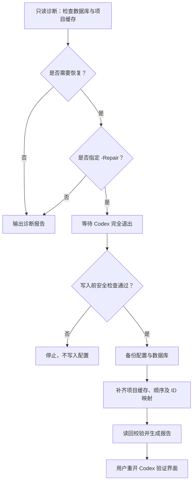

# Codex Project Recovery

**简体中文** | [English](README.en.md)

**导航：** [功能特性](#features) · [快速开始](#quick-start) · [工作原理](#how-it-works) · [进阶使用](#advanced) · [验证与限制](#verification) · [常见问题](#faq)

---

**找回 Codex 桌面端意外消失的本地项目列表。**

电脑意外关机后，Codex 的项目列表突然变空，但项目目录还在？本工具会检查本地数据库、项目目录与界面缓存之间的差异，在满足恢复条件时备份配置并补齐缺失的项目缓存。


> [!IMPORTANT]
> 适用于 **Windows 上的 Codex 桌面项目缓存缺失**，前提是本地数据库仍保有相关项目记录。不处理云端项目同步，也不会因为某个项目文件夹存在就自动创建项目。

<a id="features"></a>
## ✨ 功能特性

| 能力 | 说明 |
| :--- | :--- |
| **只读诊断** | 默认不修改配置，对比数据库与界面缓存，列出缺失项目 |
| **安全修复** | 等待 Codex 完全退出，写入前检查运行状态与源数据变化 |
| **备份与回滚** | 修改前备份配置与数据库，保留现有项目、设置和代码 |
| **读回校验** | 修复后重新读取配置进行核对，并输出 JSON 诊断报告 |

<a id="quick-start"></a>
## 🚀 快速开始

**运行要求：** Windows、Python 3.10+。无需额外安装第三方 Python 包；启动脚本会优先使用 Codex 自带的 Python。

下载或克隆仓库，在脚本所在目录打开 **PowerShell**，确保 `Recover-CodexProjects.ps1` 与 `recovery.py` 位于同一目录。

### 1. 检查缺失项目

```powershell
powershell -NoProfile -ExecutionPolicy Bypass -File .\Recover-CodexProjects.ps1
```

这一步只诊断，不修改 Codex 配置。输出示例：

```text
数据库项目 73 个，界面缓存 1 个，缺失 72 个。
缺失项中目录仍存在：69 个。
```

> 上述数量只是一次实际诊断的示例，不代表每台电脑都会得到相同结果。完整报告保存在 `recovery-results/report.json`。

### 2. 等待退出并恢复

```powershell
powershell -NoProfile -ExecutionPolicy Bypass -File .\Recover-CodexProjects.ps1 -Repair
```

**操作顺序：** 运行命令 → 完全退出 Codex（包括托盘）→ 保持 PowerShell 打开 → 等待恢复完成 → 重新打开 Codex。

- 默认最多等待 **30 分钟**，不会强制结束 Codex 进程。
- 如果等待超时，不会写入配置。
- 重新打开后，检查项目列表，再打开一个旧项目及其聊天进行人工验证。

<a id="how-it-works"></a>
## ⚙️ 工作原理

工具以**本地数据库的项目记录**为恢复依据，结合有效快照找回项目 ID 映射，并在写入前检查应用状态与源数据是否变化。



**数据处理边界：**

- **修改内容：** 项目缓存、项目顺序及 ID 映射；聊天与项目的关联需要额外开启。
- **保留内容：** 已有项目、当前设置、项目代码、聊天正文及原数据库。
- **异常保护：** 遇到数据库损坏、结构不兼容或路径冲突时停止；忽略无法解析的旧快照。
- **本地执行：** 不发送网络请求，不读取 `auth.json`；旧项目目录不存在时仍保留数据库记录并写入报告。

<a id="advanced"></a>
## 🧩 进阶使用

<details>
<summary><strong>恢复旧聊天与项目关联</strong></summary>

恢复有效快照和数据库中已有的聊天关联，同时保留当前关联：

```powershell
powershell -NoProfile -ExecutionPolicy Bypass -File .\Recover-CodexProjects.ps1 -Repair -RestoreThreadLinks
```

如果希望进一步根据聊天工作目录推断关联：

```powershell
powershell -NoProfile -ExecutionPolicy Bypass -File .\Recover-CodexProjects.ps1 -Repair -RestoreThreadLinks -InferExactCwd
```

`-InferExactCwd` 默认关闭。只有聊天工作目录与**唯一一个项目根目录完全一致**时才推断关联；不根据父目录猜测，也不会更改明确标记为无项目的聊天。此类推断不等于找到了原始关联证据。

重新打开 Codex 后，由应用同步相关迁移状态。

</details>

<details>
<summary><strong>参数与 Python 入口</strong></summary>

| 参数 | 作用 | 默认值 |
| :--- | :--- | :--- |
| `-Repair` | 等待应用退出后修复 | 关闭，仅诊断 |
| `-RestoreThreadLinks` | 恢复已有聊天关联 | 关闭 |
| `-InferExactCwd` | 按唯一、完全相同的路径推断关联，需配合上一项 | 关闭 |
| `-CodexHome` | 指定 Codex 配置目录 | `CODEX_HOME` 或用户目录下的 `.codex` |
| `-OutputDirectory` | 指定报告与备份目录 | 脚本旁的 `recovery-results` |
| `-WaitSeconds` | 等待应用退出的秒数 | `1800` |

自定义等待时间和输出目录：

```powershell
.\Recover-CodexProjects.ps1 -Repair -WaitSeconds 600 -OutputDirectory .\recovery-results
```

也可以直接调用 Python：

```powershell
python -X utf8 .\recovery.py
python -X utf8 .\recovery.py --repair
```

</details>

<details>
<summary><strong>诊断报告、备份与回滚</strong></summary>

输出目录示例：

```text
recovery-results/
├── report.json
└── backup-时间-随机值/
    ├── .codex-global-state.json
    ├── .codex-global-state.json.bak  # 仅原文件存在时
    └── state_*.sqlite
```

| 报告字段 | 含义 |
| :--- | :--- |
| `databaseProjects` / `cachedProjects` | 数据库项目数 / 诊断时的缓存项目数 |
| `missingCacheProjects` | 缓存缺失项目数 |
| `missingButDirectoryPresent` | 缓存缺失但目录仍存在的项目数 |
| `missingDirectories` | 目录不存在的项目记录 |
| `needsRepair` / `changedFields` | 是否需要修复 / 拟变更字段 |
| `readbackVerified` | 写入后是否通过读回校验 |
| `uiVerified` | 始终为 `false`，脚本不自动校验桌面界面 |

`applied_awaiting_ui_verification` 表示配置已写入并完成读回核对，**仍需要重新打开 Codex 检查界面**。

**回滚方法：** 完全退出 Codex，把备份中的 `.codex-global-state.json` 复制回原配置目录，再启动 Codex。脚本未修改原数据库，不需要覆盖数据库。

**中断后遇到锁文件：** 先确认没有恢复脚本正在运行，再删除配置目录中的 `.codex-project-recovery.lock` 并重试。

</details>

<a id="verification"></a>
## 🛡️ 验证与限制

下表保留原项目 README 中记录的测试状态：

| 检查项 | 状态 |
| :--- | :--- |
| 真实环境诊断 | ✅ 已完成；当时数据库 73 项、缓存 1 项 |
| 隔离数据修复与备份读回 | ✅ 通过；原项目、设置和数据库保留 |
| 运行中写入保护、路径冲突、损坏快照 | ✅ 通过对应检查 |
| 聊天关联、显式无项目保留、重复运行 | ✅ 通过隔离验收 |
| Python / PowerShell 语法 | ✅ 通过 |
| 原故障案例重新打开后的桌面显示 | ⚠️ 尚未记录为通过 |

> [!WARNING]
> **配置读回校验成功 ≠ 桌面界面已经恢复。** 请重新打开 Codex，检查项目列表、原目录和旧聊天，并再次运行诊断确认缺失数。

这是基于已检查的内部配置结构制作的**非官方本地恢复工具**，并非 OpenAI 官方提供。Codex 更新后，内部结构可能发生变化；数据库丢失、登录账号不同、筛选或界面加载问题需要另外排查。

<a id="faq"></a>
## ❓ 常见问题

<details>
<summary><strong>运行修复命令会强制关闭 Codex 吗？</strong></summary>

不会。脚本只等待应用完全退出，默认等待 1,800 秒；超时则停止，不写入配置。

</details>

<details>
<summary><strong>项目文件夹还在，为什么不一定能恢复？</strong></summary>

工具依赖数据库里仍然存在的项目记录，不会只根据文件夹路径重建项目。如果数据库记录已经丢失，此工具可能不适用。

</details>

<details>
<summary><strong>报告显示修复完成，项目列表却没有恢复？</strong></summary>

`readbackVerified` 仅说明文件写入后读回检查通过，不能代表 Codex 桌面界面验证成功。请先完整重开 Codex，再检查报告与项目显示情况。账号、筛选及界面加载问题也需要单独排查。

</details>
